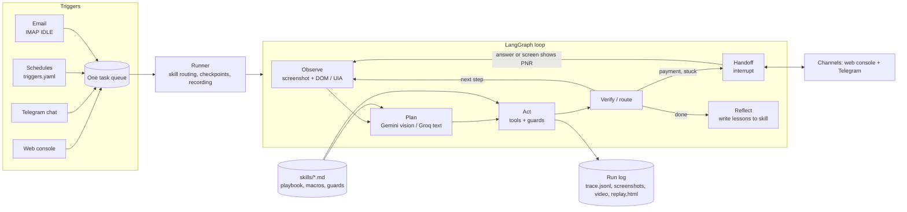

<p align="center">
  
</p>

<p align="center">
  <b>One generic computer-use agent for Windows. New jobs come from skill files, not new code.</b><br>
  Browser · desktop apps · terminal · files · schedules · email · chat · human handoff · replayable run logs
</p>

---

Harness uses a computer the way a person does: it looks at the screen, decides what to do, acts with the
mouse, keyboard, browser, shell and file system, checks the result, and repeats until the task is done or it
needs a human. What it knows about a particular job lives in a **skill**, a Markdown file with a playbook,
optional macros and safety guards. The Python code contains no site-specific knowledge.

The headline skill books the **cheapest IRCTC Tatkal ticket from Roorkee (RK) to Haridwar (HW)** the moment
the window opens at 11:00. It is hands-free: the only human action is approving the payment on a phone.
Everything runs on **free-tier models** (Google Gemini + Groq).

## Contents

- [Highlights](#highlights)
- [Architecture](#architecture)
- [How a run works](#how-a-run-works)
- [Skills](#skills)
- [Getting started](#getting-started)
- [Using Harness](#using-harness)
- [Configuration reference](#configuration-reference)
- [The IRCTC Tatkal skill](#the-irctc-tatkal-skill)
- [Run logs and replay](#run-logs-and-replay)
- [Security and privacy](#security-and-privacy)
- [Reliability](#reliability)
- [Testing](#testing)
- [Troubleshooting](#troubleshooting)
- [Project structure](#project-structure)
- [Tech stack](#tech-stack)
- [Limitations and roadmap](#limitations-and-roadmap)

## Highlights

- **Generic hands and eyes**: real Chrome over CDP, any Windows app through UI Automation and the mouse and
  keyboard, PowerShell/cmd/bash, files, an NTP-corrected clock, and local OCR.
- **Skills, not code**: 8 skills ship with the repo (IRCTC booking plus general ones for files, Office,
  desktop apps, email, web research and YouTube). With no matching skill it works zero-shot.
- **Guards enforced by code**: rules such as "never click Pay & Book twice" or "the search form must match the
  passenger file" run before every tool call, so the model can't skip them.
- **Macros** for hot paths: verified tool sequences that run without model calls (staging the IRCTC search
  takes about 8 seconds).
- **Four triggers, one queue**: web console, Telegram chat, schedules (`triggers.yaml`, millisecond timing)
  and incoming email.
- **Human handoff**: the agent pauses, asks on the web console and Telegram with a screenshot, and resumes on
  an answer or as soon as the screen shows the expected result.
- **Self-improving**: after a run with errors, it writes lessons back into the skill. It can also draft a
  new skill from a recorded demonstration.
- **Replayable run log**: every step's screenshot, reasoning, actions and results, plus a screen video and
  a self-contained `replay.html`.
- **Production habits**: per-run checkpoints (resume after a crash), self-recovery, rate-limit-aware model
  router, secrets that the model never sees, redacted logs.

## Architecture



| Component | File | Role |
|---|---|---|
| Runner | `harness/runtime/runner.py` | Picks the skill, creates the run log and a per-run SQLite checkpoint, starts the screen recording, handles handoffs |
| Agent loop | `harness/runtime/graph.py` | LangGraph state machine: observe → plan → act → verify/route → handoff → reflect |
| Guards | `harness/runtime/guards.py` | Skill-declared checks enforced on every tool call, including inside macros |
| Model router | `harness/llm/router.py` | Gemini and Groq through OpenAI-compatible APIs; several keys, per-key RPM/TPM budgets, 429 cooldowns, fallbacks |
| Perception | `harness/perception/` | Screenshots, DOM indexer with numbered elements, Windows UI Automation tree, annotated images |
| Tools | `harness/tools/` | Browser, desktop, shell, files, clock, OCR, human handoff, macros |
| Skills | `harness/skills/` | Skill loader and router, reflector (self-improving), demonstration recorder |
| Triggers | `harness/triggers/` | Daemon: schedules, chat and email feeding one task queue |
| Channels | `harness/channels/` | Web console, Telegram bot, terminal |
| Run log | `harness/runlog/` | `trace.jsonl`, step screenshots, ffmpeg video, `replay.html`, live `watch` |

### Problem statement → where it lives

| Requirement | Implementation |
|---|---|
| **Hands**: shell, files, browser, mouse and keyboard on any app | `tools/system.py` (shell, files, clock), `tools/browser.py` (real Chrome over CDP), `tools/desktop.py` (pyautogui + UI Automation) |
| **Eyes**: screenshots plus structure | `perception/`: screenshots, the page DOM with numbered elements, the Windows UIA tree, terminal output, local OCR |
| **The loop**: plan, act, observe, verify | `runtime/graph.py`; every plan first judges the previous step (`verify_previous`). After 4 failures it self-recovers up to twice before asking a human |
| **Skills**: a folder of skill files | `workspace/skills/*/SKILL.md`: playbook, optional macros and guards |
| **Triggers**: chat, schedule, event | Web console and Telegram, `triggers.yaml` schedules with NTP-corrected timing and pre-warm, email rules (IMAP IDLE) |
| **Human handoff** | `human.ask` → LangGraph `interrupt()`; question and screenshot to the console and Telegram; resumes on an answer or when the screen shows the expected state |
| **Run log for replay** | `workspace/runs/<id>/`: `trace.jsonl`, step screenshots, video, `replay.html` |
| **Bonus: self-improving skills** | `skills/reflector.py` appends lessons to a skill after runs with errors (backup in `history/`) |
| **Bonus: skills from a demo** | `harness learn` records a demonstration and drafts a `SKILL.md` |
| **Generic, not IRCTC-only** | No site knowledge in code; zero-shot when no skill matches |

## How a run works

1. **Observe**: in the browser, every visible interactive element gets a number (`[14] <button> "Book Now"`);
   elements hidden behind a dialog are left out, password fields stay masked, and the screenshot gets matching
   boxes. On the desktop the same comes from the foreground window's UI Automation tree.
2. **Plan**: one model call returns JSON with `verify_previous` (did the last step work?), a short reason,
   the current phase and 1–6 actions. Groq's fast text model is used when the element list is enough; Gemini
   vision is used on the desktop, after a failure, on the first step or when a skill asks for it.
3. **Act**: each action passes the skill's guards, then runs. Secrets (`{{secret.NAME}}`) are filled in only
   at this point, so the model never sees them.
4. **Verify and route**: tool errors, a failed `verify_previous` or a repeated action count as failures. After
   4 in a row the agent self-recovers (a fresh look with vision) up to twice, then asks a human. Irreversible
   shell commands need approval.
5. **Handoff**: the run pauses (checkpointed), the question and a screenshot go to the console and Telegram, and
   it resumes on an answer or automatically when the screen shows the expected text (for example "PNR").
6. **Reflect**: after a run that hit errors or needed a human, at most 2 lessons are added to the skill. A
   successful run without a skill becomes a draft skill.

## Skills

A skill is a folder under `workspace/skills/` with one `SKILL.md`:

~~~markdown
---
name: files_and_terminal
description: Organise, find, rename, move, zip and inspect files and folders with PowerShell.
triggers: ["file", "folder", "downloads", "rename", "zip", "powershell"]
vision: never            # never | auto | always
max_steps: 50
guards:                  # optional, enforced by the harness
  - name: no_delete_without_approval
    when: {tool: shell.run, args_lack: "-WhatIf"}
    run_macro: check_paths
---
# Playbook in plain Markdown: steps, verified facts, recovery tips.

```yaml macros
check_paths:
  steps:
    - {tool: shell.run, args: {command: "Get-ChildItem $HOME\\Downloads | Select -First 5"}}
```
~~~

**Included skills**

| Skill | What it covers |
|---|---|
| `irctc_tatkal_booking` | Login with captcha, search staging, strike at 11:00, cheapest 2S fare, passenger, PhonePe QR handoff, PNR proof |
| `files_and_terminal` | Organise, rename, zip, search files; PowerShell tasks |
| `office_documents` | Excel, Word and PowerPoint through COM or the app itself |
| `web_research_to_file` | Look something up on the web and save the result |
| `web_to_spreadsheet` | Turn a web table into an Excel sheet |
| `windows_desktop_basics` | Open apps, File Explorer, Notepad and other desktop work |
| `email_and_messages` | Read, draft and send email; act on an incoming email |
| `play_popular_youtube_video` | Drafted by the agent itself after a successful YouTube run |

**Guards** (in the frontmatter) run before every matching tool call:

| Kind | Effect |
|---|---|
| `block: "reason"` | Refuse the action and tell the agent why |
| `run_macro: name` | Run a check macro first; the action happens only if it passes |
| `min_interval_s: N` | Refuse a repeat of the same action within N seconds (anti double-submit) |
| `defaults: {arg: value}` | Fill in arguments the model left out |

`when:` conditions: `tool`, `macro`, `click_text`, `url_contains`, `task_contains`, `args_lack`.

**Adding a skill**: copy a folder, edit the frontmatter and playbook, then check routing with
`.\harness skills --match "your task"`. To draft one from a demonstration, run
`.\harness learn --name my_skill --description "what it does"`, do the task once, and stop with
**Ctrl+Shift+Q**.

## Getting started

### Prerequisites

| Requirement | Notes |
|---|---|
| Windows 10 or 11 | Desktop tools use Windows UI Automation |
| Python 3.12+ | `python --version` |
| Google Chrome | Default path `C:\Program Files\Google\Chrome\Application\chrome.exe` (change with `CHROME_PATH`) |
| Git | To clone the repo |
| ffmpeg (optional) | For screen-recording each run: `winget install ffmpeg` |
| Free API keys | Gemini: [aistudio.google.com/apikey](https://aistudio.google.com/apikey) · Groq: [console.groq.com/keys](https://console.groq.com/keys) |
| Telegram bot (optional) | For handoffs and chat on your phone: create one with [@BotFather](https://t.me/BotFather) |

### 1. Clone

```powershell
git clone https://github.com/sunnyyadav3339/harness-agent.git
cd harness-agent
```

### 2. Create the virtual environment and install

The launcher `harness.cmd` looks for the venv at `%USERPROFILE%\.venvs\agenticps` (outside the repo, so a
synced folder like OneDrive never touches it). To use another location, set `HARNESS_VENV`.

```powershell
python -m venv $env:USERPROFILE\.venvs\agenticps
& $env:USERPROFILE\.venvs\agenticps\Scripts\python -m pip install -e ".[dev]"
```

### 3. Configure

```powershell
copy .env.example .env
copy workspace\data\passenger.example.yaml workspace\data\passenger.yaml
```

Then edit `.env`:

1. **Model keys**: `GEMINI_API_KEYS` and `GROQ_API_KEYS`, comma-separated. One key per account or project:
   free quotas are per project, so extra keys from the same account add nothing.
2. **Telegram (optional)**: put the bot token in `TELEGRAM_BOT_TOKEN`, send your bot a message from your phone,
   run `.\harness telegram-setup`, and copy the printed chat id into `TELEGRAM_CHAT_IDS`.
3. **Secrets for the IRCTC skill**: `SECRET_IRCTC_USERNAME`, `SECRET_IRCTC_PASSWORD` (and `SECRET_UPI_ID` if
   used). Or store them in Windows Credential Manager instead of `.env`:
   `.\harness secret set IRCTC_PASSWORD`.
4. **Email trigger (optional)**: `IMAP_USER` and `IMAP_PASSWORD` (a Gmail app password).

Fill in `workspace\data\passenger.yaml` (name, age, gender, mobile). It is git-ignored.

### 4. Check everything

```powershell
.\harness doctor
```

It tests the keys and models, Chrome, the clock and the channels, and must end with `READY`.

### 5. Start

```powershell
.\harness daemon
```

Open **http://127.0.0.1:8765**, type a task such as *"Open YouTube, search for Shape of You by Ed Sheeran and
play the official music video"* and press Enter. The agent opens its own Chrome window; keep that window in
front while it works.

## Using Harness

### Web console (http://127.0.0.1:8765)

- **Task box**: plain-English tasks; the skill is picked automatically or chosen from the list. Press `/` to
  jump to it, Enter to run.
- **Run view**: phase bar, the agent's current screen, and an activity feed of every step with its reason
  and result; click a step to see its screenshot.
- **Approval card**: handoff questions appear with a screenshot, buttons and a countdown.
- **Sidebar**: upcoming schedules, recent runs (with replay links), skills, daemon health.

The console listens on `127.0.0.1` only. Set `WEB_PORT=0` in `.env` to turn it off.

### Command line

| Task | Command |
|---|---|
| Daemon (console, schedules, Telegram, email) | `.\harness daemon` |
| Run one task now | `.\harness run "organise my downloads folder by file type"` |
| Force a skill | `.\harness run --skill irctc_tatkal_booking "REHEARSAL: ..."` |
| Develop without grabbing the screen | `.\harness run --background --no-record "..."` |
| Follow a run live in the terminal | `.\harness watch --new` |
| Resume a crashed run | `.\harness resume <run_id>` |
| Rebuild a replay page | `.\harness replay workspace\runs\<run_id>` |
| Validate skills / test routing | `.\harness skills --match "some task"` |
| Draft a skill from a demonstration | `.\harness learn --name export_report --description "..."` |
| Store a secret | `.\harness secret set IRCTC_PASSWORD` |
| Health check | `.\harness doctor` |

### Telegram

`/run <task>` (or just type the task), `/status`, `/stop`, `/skills`, `/jobs`, `/clock`. During a handoff, tap
a button or reply with text.

### Schedules

`workspace/config/triggers.yaml` is re-read every 30 seconds, so schedules can change while the daemon runs:

```yaml
schedules:
  - id: tatkal_book
    enabled: true
    at: "2026-10-25 10:56:30"     # one-shot; or cron: "0 9 * * 1-5"
    prewarm_s: 150                # sync the clock, warm models and Chrome beforehand
    skill: irctc_tatkal_booking
    priority: 1
    task: >-
      Book the cheapest Tatkal ticket from Roorkee (RK) to Haridwar (HW) for tomorrow ...

email:
  - id: report_request
    subject_contains: "send report"
    task: "Reply to the email from {from} with today's report"
```

## Configuration reference

### `.env`

| Variable | Purpose |
|---|---|
| `GEMINI_API_KEYS`, `GROQ_API_KEYS` | Comma-separated model keys |
| `TELEGRAM_BOT_TOKEN`, `TELEGRAM_CHAT_IDS` | Telegram bot and allowed chat ids |
| `IMAP_HOST`, `IMAP_USER`, `IMAP_PASSWORD`, `IMAP_OAUTH_TOKEN` | Email trigger |
| `SECRET_<NAME>` | Secrets the agent may type as `{{secret.NAME}}` but never sees |
| `HARNESS_WORKSPACE` | Use a different workspace folder (for example a Google Drive folder) |
| `CHROME_PATH`, `CDP_PORT` | Chrome location and debugging port (default 9222) |
| `WEB_PORT` | Console port (default 8765; 0 disables it) |
| `HARNESS_VENV` | Virtual environment used by `harness.cmd` |

### `workspace/config/`

| File | Purpose (all hot-reloaded) |
|---|---|
| `models.yaml` | Model groups (vision, fast text), providers, timeouts, rate budgets |
| `triggers.yaml` | Schedules and email rules |
| `policy.yaml` | Actions that need human approval |
| `runtime.yaml` | Loop limits and timings |

## The IRCTC Tatkal skill

What it does, verified on the live site:

1. **Login**: types the user id and password, solves a captcha with local OCR if shown, retries on
   "Invalid Request" with a fresh session.
2. **Stage**: fills From, To, date and quota a few minutes early with the `stage_search` macro.
3. **Strike**: waits for `11:00:00.400` on an NTP-corrected clock, then clicks Search.
4. **Cheapest**: opens 2S on 12054 and 12055 (the only trains with 2S on this route) and books the cheaper
   available one; on a tie, the earlier departure.
5. **Passenger**: fills the passenger from `passenger.yaml`, sets no insurance, BHIM/UPI and "book only if
   confirmed"; a guard checks all of it before Continue.
6. **Pay**: Multiple Payment Service → PhonePe → Pay & Book → QR. The QR goes to the console and Telegram; you
   scan and approve on your phone.
7. **Proof**: resumes by itself when the PNR appears and saves `ticket_pnr_proof.png` in the run folder.

**Booking day checklist**

1. `.\harness doctor` → `READY`; set the dates in `triggers.yaml`.
2. Laptop on charger, personal hotspot, sleep off. Start `.\harness daemon` and check the console lists the
   schedules.
3. Keep the agent's Chrome window in front and don't log in to IRCTC anywhere else.
4. When the QR arrives, scan it and approve. Everything else is automatic.

Avoid testing between 23:45 and 00:20: IRCTC is down for maintenance then.

## Run logs and replay

Each run gets `workspace/runs/<YYYYMMDD_HHMMSS>_<skill>/`:

| File | Content |
|---|---|
| `run.json` | Task, skill, trigger, status, step and handoff counts, summary |
| `trace.jsonl` | One record per step and event: reason, actions, results, timings, guard checks, handoffs |
| `steps/` | Screenshot and annotated screenshot per step |
| `video/` | Screen recording of the run (needs ffmpeg) |
| `replay.html` | Self-contained page to step through the whole run |

Follow a run live with `.\harness watch --new`, or open it in the console.

## Security and privacy

- Credentials come from `.env` or Windows Credential Manager; the model only ever sees placeholders.
- Secret values are redacted from logs, traces and `run.json`; password fields are re-masked after every action.
- `.env` and `passenger.yaml` are git-ignored.
- The console binds to `127.0.0.1` and serves files only from the runs folder.
- Irreversible shell commands (delete, push, shutdown…) need approval (`policy.yaml`).

## Reliability

- Per-run checkpoints in `%LOCALAPPDATA%\agenticps\state` (never in a synced folder): `.\harness resume <id>`.
- Append-only, fsync'd trace, so a crash still leaves a replayable log.
- Self-recovery before asking a human; time limits on every observation.
- Anti double-submit guards; recovery from IRCTC's error page.
- Clock offset from NTP (the system clock is never changed), re-synced every 10 minutes.
- Chrome runs from its own profile with a debugging port, detached from the harness so it survives restarts.
- `models.yaml` and `triggers.yaml` reload without a restart.
- Logs: `%LOCALAPPDATA%\agenticps\logs` (rotating).

## Testing

```powershell
& $env:USERPROFILE\.venvs\agenticps\Scripts\python -m pytest -q
```

28 tests cover the agent loop end to end, guards, parsing and credentials, and the web console.

## Troubleshooting

| Problem | Fix |
|---|---|
| `Virtual environment not found` | Create the venv at `%USERPROFILE%\.venvs\agenticps` or set `HARNESS_VENV` |
| `ModuleNotFoundError` | You ran the system Python; always use `.\harness ...` |
| `doctor` warns about a model | Check the key; swap the model in `models.yaml` (reloads live) |
| Chrome doesn't attach | Close other Chrome instances using port 9222, or change `CDP_PORT` |
| Steps are slow or fall back to "desktop" | The agent's Chrome window is covered or minimized; keep it in front |
| Rate-limit errors (429) | Add keys from other accounts; the router cools down and falls back |
| No Telegram messages | Run `.\harness telegram-setup` and check `TELEGRAM_CHAT_IDS` |
| IRCTC error page or "Invalid Request" | The skill recovers by itself; avoid running two IRCTC sessions at once |

## Project structure

```
harness/                    code (no site knowledge)
  runtime/                  graph.py (loop), runner.py, guards.py, context.py, prompts.py
  llm/                      router.py, parsing
  perception/               browser view (DOM indexer), desktop view (UIA), screenshots
  tools/                    browser.py, desktop.py, system.py, vision.py, control.py, base.py
  channels/                 web.py + web_console.html, telegram.py, console.py
  triggers/                 daemon.py, email_imap.py
  skills/                   loader.py, reflector.py, demo.py
  runlog/                   logger.py, recorder.py, replay.py, watch.py
  cli.py                    command line
workspace/                  everything editable without touching code
  skills/<name>/SKILL.md    skills (+ history/ backups of learned changes)
  data/                     passenger.example.yaml (copy to passenger.yaml)
  config/                   models.yaml, triggers.yaml, policy.yaml, runtime.yaml
  runs/                     run logs (created automatically, git-ignored)
tests/                      pytest suite
docs/                       logo
harness.cmd                 launcher that uses the virtual environment
```

## Tech stack

| Area | Technology |
|---|---|
| Language | Python 3.12, Windows 11 |
| Agent loop | LangGraph, SQLite checkpoints (aiosqlite) |
| Models | Google Gemini 3.5 Flash-Lite (vision), Groq Qwen3 (fast text), OpenAI-compatible APIs via httpx |
| Browser | Patchright driving real Chrome over CDP |
| Desktop | pyautogui, pywinauto (UI Automation), pywin32 |
| Vision and OCR | mss, Pillow, ddddocr |
| Scheduling and time | APScheduler, ntplib, tzdata |
| Triggers and handoff | Telegram Bot API, IMAP IDLE, asyncio web server |
| Config and secrets | pydantic-settings, PyYAML, python-dotenv, keyring |
| Run log | JSONL, ffmpeg, HTML replay |
| Tests | pytest, pytest-asyncio |

## Limitations and roadmap

- Windows only; one task at a time, because there is one screen.
- Free-tier model latency varies (about 1–4 seconds per step).
- The agent works on the foreground window, so its Chrome must stay visible during runs.
- Next: virtual-desktop awareness, a skill editor in the console, automatic skill tests on recorded pages,
  and parallel runs in separate VMs.
